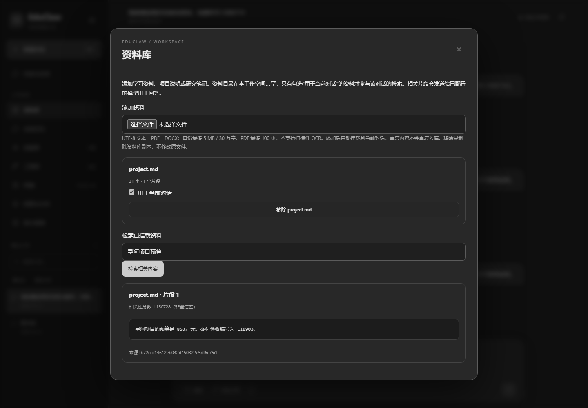

# EduClaw

**从一个问题，到一件完成的事。**

面向学习、研究与日常工作的个人 AI Agent。用普通对话讨论想法、查询公开资料；需要操作文件或持续推进时，转为可追踪的任务，或把目标交给本机终端 Agent。

[使用文档](https://weiyu687.github.io/EduClaw/) · [GitHub Wiki](https://github.com/weiyu687/EduClaw/wiki) · [安装指南](https://weiyu687.github.io/EduClaw/Getting-Started.html) · [开发进度](docs/DEVELOPMENT_STATUS.md)


*当前开发版实机界面。对话内容为文档演示数据；下方任务与终端截图中的命令输出来自实际 Windows 执行。*

## 可以做什么

| 场景 | 使用方式 |
| --- | --- |
| 交流、解释、写作与学习规划 | 普通多轮对话，支持继续追问、摘要命名、重命名与删除会话 |
| 最新资讯与公开知识 | 在对话中查询新闻或 Wikipedia 资料，返回来源；搜索服务无需密钥，模型服务仍需配置 |
| 文档与数据处理 | 读取 PDF、Word、PPTX、Excel、CSV、文本、JSON、JSONL，结合 Python 计算和保存结果 |
| 多步骤交付 | 自动选择已适配工具，展示步骤、依赖、执行状态及结果证据；支持暂停、取消与恢复 |
| 本机项目工作 | 在指定初始目录打开持续 PowerShell 终端，读写文件、运行测试、使用 Git、检查网络 |
| 控制自动化程度 | 当前对话选择逐步确认、平衡模式或自主执行，随时调整，工具禁用始终优先 |
| 扩展工作方法 | 浏览与偏好挂载 Skills；通过 MCP 和受信任工具契约接入能力 |
| 长对话与个人资料 | 近期窗口、抽取式历史摘要与相关记忆召回；上传资料，按对话挂载并检索引用 |
| 专业领域工作 | 专家模式组合提示词、工作流程、Skills、任务工具和资料，支持自定义、版本快照与导入导出 |

## 先聊，再决定如何执行

普通提问和单次搜索直接在对话完成。需要文件、代码或多阶段操作时，助手会提出任务建议，展示结合上下文整理的完整目标。点击“准备任务 · 确认后提交”，可以修改目标，再提交规划。

任务按目标选择工具，不必逐项勾选。已有结果会保留，执行失败或状态不确定时停止推进，不自动重放有副作用的操作。


## 自由度由你选择

在侧栏 **权限与文件** 设置当前对话的审批模式；GUI 与 CLI 共用。

| 模式 | 行为 |
| --- | --- |
| 逐步确认 | 工具调用和终端 Agent 输入先确认 |
| 平衡模式（默认） | 公开查询、已授权读取、工作目录内新建文本自动执行；覆盖、代码和终端保留审批规则 |
| 自主执行 | 用户明确授权后，已启用的适配工具自动执行，包括代码、文件覆盖与终端输入 |

模式按对话保存，重启保留，新对话仍默认平衡模式。自主执行不解除工具禁用，也不让未知工具获得权限。**本机终端使用当前 Windows 用户权限，初始目录不是沙箱。** 切换模式约束后续调用；已经开始的命令需用停止按钮中断。


## 持续终端

侧栏打开 **终端**，设置目录并确认本机权限。可以直接输入命令，也可以输入自然语言目标，让 Agent 根据真实输出执行、观察、修正与验证。

> 检查当前项目，运行测试；根据报错修复后再次测试，并说明修改内容。

PowerShell 会保留目录、变量和交互程序。支持 Ctrl+C、关闭进程树、GUI 与 CLI 访问同一终端。关闭面板不会结束进程。当前是文本输入输出面板，不是完整的全屏终端模拟器。


## 会话记忆与资料库

侧栏 **会话记忆** 可以检查历史摘要、检索原始对话，并查看上次回答使用的上下文。回答前组合最近最多 8 轮、历史抽取式摘要、最多 4 个相关记忆片段和 5 个资料片段，总输入限制为 32,000 字符。压缩不会删除原始聊天记录，记忆按会话隔离。

侧栏 **资料库** 添加 UTF-8 文本、Markdown、CSV、JSON、JSONL、LOG、PDF 或 DOCX。每份最多 5 MB / 30 万字符，PDF 最多 100 页；扫描件暂不支持 OCR。上传后自动用于当前对话，也可取消挂载。其他对话需要自行勾选后才能检索内容。

普通对话直接提问即可使用资料；检索预览展示来源和排序分数。相关片段会发送给配置的模型。检索采用本地 Model2Vec/POTION 多语言静态向量与 BM25 的 RRF 排名融合，保留关键词精确匹配并补充语义候选；模型未安装时明确回退到关键词。分数不是置信度，不保证所有改写都能召回。只保留统一资料库，旧检索适配器共用该存储；旧 Chroma 内容需重新导入原文件。



## 专家模式

侧栏 **专家模式** 提供研究、软件工程、教学和数据分析预设。可为其他领域组合角色要求、流程、已安装技能、可信工具和资料，也可导入导出 JSON 配置。开启时保存版本快照，不修改已有审批权限；退出后恢复手动资料挂载范围。

顶部普通对话/任务模式切换始终吸顶。专家配置作用于两种模式及终端 Agent，无需为使用专业资料另建任务。

轻量语义检索一次性安装：

```powershell
python -m pip install -r integrations/retrieval/requirements.txt
python scripts/setup_retrieval.py
```

模型约 530 MB，CPU 本地运行，正常检索不联网下载或发送嵌入请求。论文依据、领域扩展方法和实测边界见 [专家模式与检索](https://weiyu687.github.io/EduClaw/Expert-Mode.html)。可扩展的结构不等于已经具备所有专业的专家水平，每个新领域仍需资料与实际验收。

## 安装与启动

当前活跃开发分支是 `codex/roadmap-development`，已验证平台为 Windows、Python 3.11、Node.js/npm 和 Microsoft Edge。Python 代码沙箱需要 Docker；本机终端无需 Docker。

项目尚未提供完整锁定的 Python 安装清单或一键安装包。先按[安装指南](https://weiyu687.github.io/EduClaw/Getting-Started.html)准备 Python 环境和工具依赖，再执行：

```powershell
git clone --branch codex/roadmap-development https://github.com/weiyu687/EduClaw.git
cd EduClaw
python -m pip install -r integrations/terminal/requirements.txt
npm ci --prefix integrations/filesystem
npm ci --prefix web
npm run build --prefix web
```

在仓库根目录的本地 `.env` 配置模型：

```dotenv
EDUCLAW_MODEL_NAME=your-model
EDUCLAW_MODEL_API_URL=https://your-provider.example/v1
EDUCLAW_MODEL_API_KEY=your-local-key
```

启动后打开终端输出的**本次启动地址**：

```powershell
python -m core.gui.server
```

服务仅监听本机，重启后访问凭据会更新。CLI 入口：

```powershell
python -m core.usr.main
```

## GUI 与 CLI 对照

| 想做的事 | GUI | CLI |
| --- | --- | --- |
| 普通对话 | 普通对话输入框 | `/聊天`，或 `/chat 消息` |
| 选择会话 | 左侧历史对话 | `/sessions`、`/use ID` |
| 创建自动任务 | 任务模式输入目标 | `/agent 目标` |
| 查看任务与结果 | 任务列表、执行步骤、结果证据 | `/任务`、`/状态`、`/结果` |
| 调整审批模式 | 权限与文件 | `/autonomy strict`、`balanced`、`autonomous` |
| 操作持续终端 | 终端面板 | `/term` 查看用法 |
| 浏览技能与工具 | 技能库、工具库 | `/skills`、`/tool-sync`、`/permissions` |
| 检查会话记忆 | 会话记忆 | `/memory [检索词]` |
| 添加与检索资料 | 资料库 | `/library add 路径`、`/library search 问题` |
| 选择专业领域 | 专家模式 | `/expert use ID`、`/expert off`、`/expert import JSON路径` |

使用同一个数据目录和会话，才能在两端看到相同记录。[完整指令参考](https://weiyu687.github.io/EduClaw/Commands.html)。

## 开发与验证

界面使用 TypeScript、React、Vite；后端使用 Python、LangGraph、MCP 和 SQLite。工具契约与权限网关共同约束调用，任务账本记录执行认领和结果。Skills 提供方法，不授予权限。

```powershell
npm test --prefix web
npm run build --prefix web
python -m pytest test/test_chat_actions.py test/test_autonomy.py test/test_interactive_terminal.py -q
python scripts/windows_chat_handoff_e2e.py
python scripts/windows_autonomy_e2e.py
```

Windows 验收覆盖真实浏览器交互、CLI、MCP、文件、Docker 计算及持续终端。部分脚本需要模型网络连接和 Docker；详细环境、范围与日志见[测试与开发](https://weiyu687.github.io/EduClaw/Development.html)。

## 当前边界

- 当前为持续开发版，主要验证 Windows 本机使用；尚无桌面安装包、多用户部署或完整生产安全审计。
- 任意第三方 MCP 工具发现不等于可执行，仍需契约、权限与适配测试；没有通用工具一键安装。
- 公开新闻来自 RSS，资料检索使用 Wikipedia；网络可用性和覆盖范围有限，摘要不代表阅读全文。
- 记忆采用有损抽取摘要及轻量混合召回，仍会漏召回或误召回；尚无跨会话个人画像或自动更新机制。

欢迎通过 [Issues](https://github.com/weiyu687/EduClaw/issues) 提交复现步骤、使用场景或建议；提交日志前请移除密钥与私人数据。第三方技能的许可证和固定来源保留在对应目录；仓库根目录目前没有独立 LICENSE 文件，不在本文重新声明整体许可。

## English

EduClaw is a personal AI agent for learning, research, and everyday work. The local TypeScript/React interface combines multi-turn chat, public search, traceable tasks, Skills/MCP integrations, and a persistent Windows terminal agent. Users choose per-session approval modes; terminal access uses the current Windows account's permissions.

This is an actively developed Windows-first project. See the [documentation](https://weiyu687.github.io/EduClaw/) for setup, current limitations, and real end-to-end test workflows.
