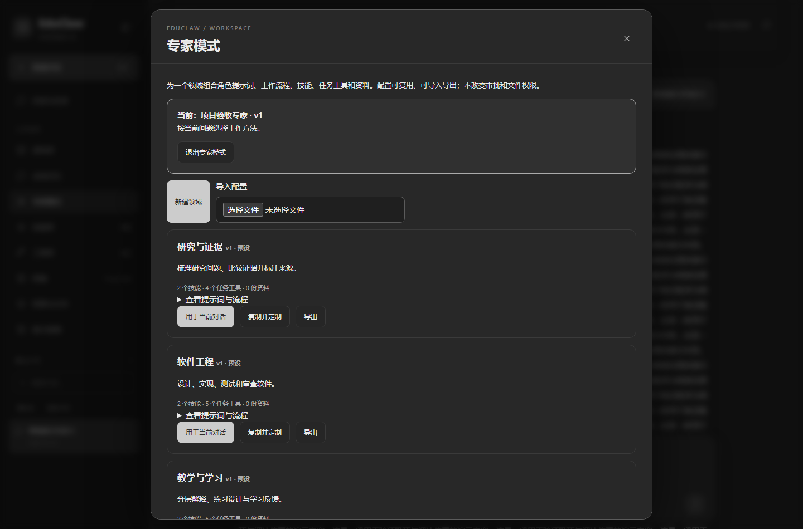

# 专家模式与轻量检索

## 从通用助手到领域工作台

专家模式是一层可配置的领域工作方法，不是另一个聊天或任务模式。它可同时用于普通对话、任务规划和持续终端 Agent。

一个领域配置包含名称与说明、角色提示词、工作流程、已安装的 Skills、可信任务工具范围，以及统一资料库中的资料。内置研究与证据、软件工程、教学与学习、数据分析四个预设；可以复制定制，也可新建其他专业的配置。



## GUI 操作

1. 选择当前会话，打开侧栏“专家模式”。
2. 直接启用预设，或者“复制并定制” / “新建领域”。
3. 填写领域 ID、名称、提示词和工作流程。流程可以包含专业术语、诊断顺序、交付格式和验收清单。
4. 选择已有技能与任务工具。未选工具时沿用自动工具；选中后新任务只从该范围内的已启用工具规划。
5. 在“资料库”先添加专业资料，再在领域配置中选中。无需另建语料库。
6. 保存后点击“用于当前对话”。保存配置本身不会改变已开启的会话。

配置具有版本。启用时保存该版本快照；修改模板后，需要重新启用才能应用新版。删除可选配置不会静默更改其他会话的快照；要停止使用请在相应会话点击“退出专家模式”。

领域资料叠加在手动挂载之上：退出领域后停止领域挂载，但手动挂载继续保留。资料库会明确标记来自专家模式的挂载。删除资料库文件会使所有挂载失效，历史回答中已保存的引用仍保留。导出的 JSON 引用本工作空间的资料 ID，跨工作空间导入前须重新导入原资料并调整 ID。

顶部普通对话/任务模式栏始终吸顶，长对话和任务详情中均可点击；切换时保留聊天阅读位置。

## CLI 与扩展

```text
/expert list
/expert use research
/expert show
/expert off
/expert import "D:\profiles\my-domain.json"
/expert use my-domain
/expert remove my-domain
```

JSON 文件不含自动授权或可执行脚本字段。示例：

```json
{
  "id": "my-domain",
  "name": "实验记录审阅",
  "description": "核对实验假设、记录完整性和可复现性",
  "prompt": "区分观察、假设和推断。引用记录中的证据，缺失信息明确列出。",
  "workflow": "检查变量与单位 → 核对控制条件 → 复核数据 → 列出待验证问题",
  "skills": ["research-evidence", "data-quality"],
  "tools": ["extract_text", "extract_csv", "profile_csv"],
  "documents": []
}
```

需要新专业工具时，按 [技能与工具](Skills-and-Tools) 的契约/MCP 适配流程安装并测试，再纳入领域配置。单纯填写一个工具名称不会安装或授权它。自定义流程可直接放入领域配置；需要复用的独立 Skill 可保存到 `skills/<id>/SKILL.md`。

GUI 与 CLI 普通对话、`/agent` 和兼容 `/multi` 规划使用相同领域配置。持续终端 Agent 在本轮开始时读取提示词、技能与资料快照；任务工具范围只约束任务规划器，不是终端命令白名单。已开始的任务不因切换领域而改写。

领域配置不改变审批模式、工具禁用、文件授权和操作系统权限。切换领域不清空会话历史；需要不同专业的历史隔离时，新建会话。

## 本地轻量语义检索

原先只有中英文 BM25 关键词匹配。现在默认在本地模型可用时组合：

- **Model2Vec / POTION 多语言静态向量**：通过蒸馏后的词元向量快速编码，256 维，不需要 GPU 或逐次 LLM 调用。
- **BM25 关键词候选**：保留编号、名称、代码词等精确匹配。
- **RRF 排名融合**：融合两路前 60 个候选，过滤弱语义匹配，并去除高度重复片段。
- **有界向量缓存**：同一进程最多缓存 8192 个文本摘要对应的向量；先按会话/资料挂载过滤，再检索。查询文本不会发送给嵌入服务。

静态模型对复杂句意的理解弱于大型上下文模型。默认语义余弦门槛 0.25，且保留距最高相似度不超过 0.12 的候选；这些是工程阈值，不是概率，也不保证检索结果正确。

一次性安装（模型文件约 530 MB，不提交到 Git）：

```powershell
python -m pip install -r integrations/retrieval/requirements.txt
python scripts/setup_retrieval.py
```

安装脚本固定 Hugging Face 模型提交 `73908c3438cf03b6a01bcb9611d62b23d0726f08`，只下载配置、Tokenizer、Safetensors 权重和模型说明。正常对话不会下载模型，不执行远程模型代码。断网或未安装时继续使用 BM25，并在会话记忆面板明确显示回退原因。

可以用 `EDUCLAW_RETRIEVAL_MODEL` 指定兼容 Model2Vec 的本机模型目录；`EDUCLAW_RETRIEVAL_MODE=lexical` 可强制使用关键词模式。修改后重启服务。不同模型的阈值需重新验证。

## 实测与适用边界

运行 `python scripts/benchmark_retrieval.py` 可复现本机校准用的 10 条中英文改写样例。当前前五名召回 9/10（旧版 4/10），首位命中 6/10（旧版 4/10）；小语料热缓存约 0.5–0.7 毫秒，首次加载约 2.2 秒。这不是独立测试集或公开基准，不能据此声称跨领域准确率 90%。仍有未召回的问题和排序靠前的干扰项。

Windows 验收脚本 `scripts/windows_experts_e2e.py` 实际创建领域、选择技能/工具/资料、用真实模型回答并引用资料、用真实模型规划单工具任务、从 CLI 读取和退出配置，并检查桌面与窄屏吸顶。新领域应补充自己的代表性问题、可核实预期答案和真实工具任务，再判断是否适用。

可扩展到任何领域的配置结构，不等于已具备任何领域的专家能力。效果取决于基础模型、资料质量、工具覆盖与领域验收；该功能不授予专业资格。

## 研究依据

实现借鉴下列研究方向，未声称复现论文的完整系统或实验分数：

- [Rethinking Hybrid Retrieval（2025）](https://arxiv.org/abs/2506.00049)：比较小嵌入模型与多信号检索组合，支持在本项目先评估轻量混合方案。本文实现没有使用其图检索和 LLM 重排。
- [Agent KB（2025）](https://arxiv.org/abs/2507.06229)：将可复用工作经验与规划检索结合，启发本项目把领域流程和资料一并提供给规划与回答。未实现跨框架轨迹学习或论文中的分歧门控。
- [SkillRAE（2026）](https://arxiv.org/abs/2605.10114)：研究检索技能与执行上下文的组织，启发有预算的领域指导组装；本项目使用显式选择与版本快照，不是该论文的训练/检索系统。
- [Model2Vec 官方实现](https://github.com/MinishLab/model2vec)和 [POTION 多语言模型卡](https://huggingface.co/minishlab/potion-multilingual-128M)：本地静态向量的实现及模型来源，遵循其 MIT 许可。轻量主要指 CPU 推理成本，模型权重本身约 512 MB。
