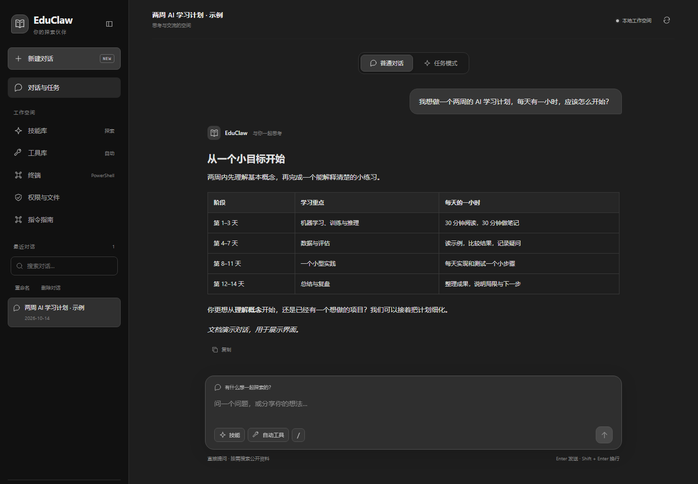
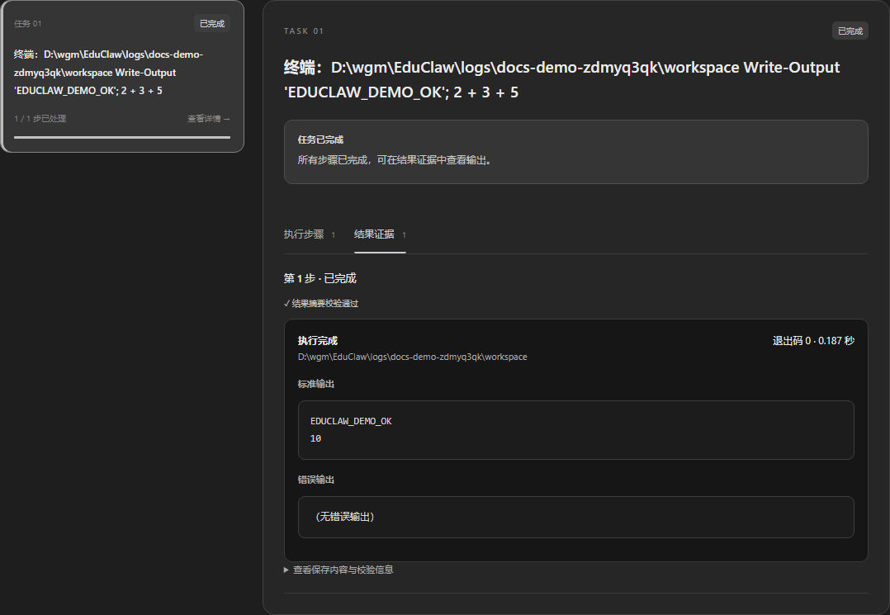
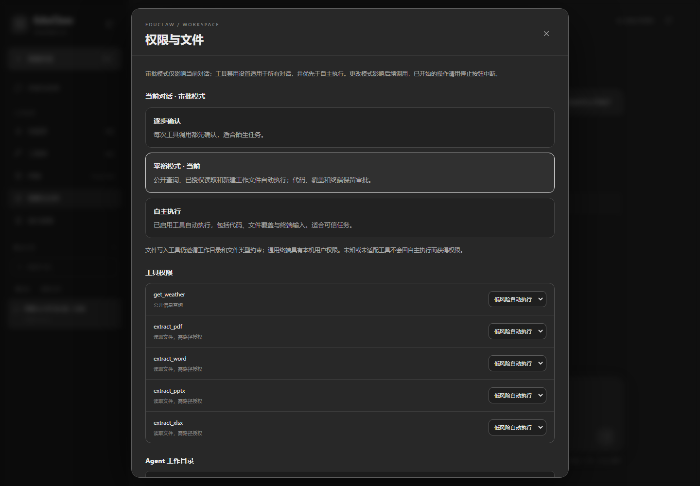
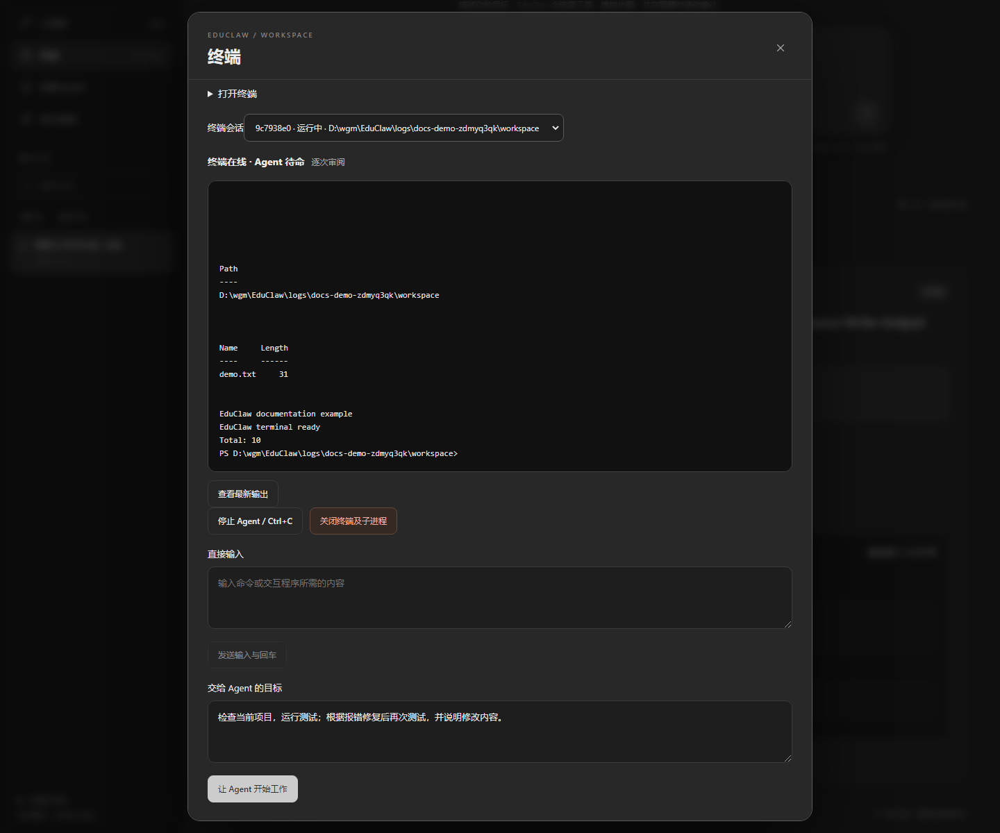

# GUI 使用指南

## 认识工作台

左侧管理历史对话、技能库、工具库、终端、权限与文件、指令指南。主区域在普通对话和任务模式之间切换，两种模式属于同一会话。

截图使用演示对话。输入框按 Enter 发送，Shift + Enter 换行；中文输入法选词不会触发提交。

## 普通对话与搜索

1. 点击“新建对话”，直接输入问题或想法。
2. 继续追问，助手会使用最近的普通对话上下文。
3. 查询最新资讯可直接说“给我昨天的 AI 新闻，归纳重点并列出来源”，无需切换任务模式。
4. 阅读回答中的来源。新闻摘要基于取得的标题与摘要，不代表阅读全文。

会话自动按主题命名，也可以在侧栏重命名或删除。删除先预览影响，再确认；正在回复或存在未结束任务时需先处理。切回普通对话会恢复阅读位置；原来在底部则继续显示最新内容，阅读较早内容时不会被轮询拉走。

## 从建议创建任务

文件、代码或分阶段操作可能触发“建议创建任务”。卡片会显示建议原因和结合上下文整理的完整目标。

1. 核对卡片中的任务目标。
2. 点击“准备任务 · 确认后提交”。
3. 任务输入框会带入卡片中的目标，而非用户最后一句简短追问。
4. 修改路径、范围与交付要求后，点击提交。

准备草稿本身不会执行。你也可以直接切到任务模式输入完整目标。提交后按审批模式推进；平衡模式下公开查询和已授权的低风险步骤可能立即开始。

## 查看任务与结果

“最近提交”显示规划状态；点击“查看任务”，在任务列表中选择对应项。

- **执行步骤**：工具、参数、依赖和当前状态。
- **结果证据**：保存的输出、完整性摘要；终端步骤还显示退出码、标准输出、错误输出和耗时。
- **暂停**：阻止后续步骤；**取消任务**：请求停止任务执行；**恢复**：先预览恢复范围。

截图中的 `EDUCLAW_DEMO_OK` 与计算结果来自真实 PowerShell 命令。执行失败或结果不确定时先查看证据，不要反复提交同一有副作用的操作。

## 选择审批模式

打开侧栏“权限与文件”。

| 模式 | 何时选择 |
| --- | --- |
| 逐步确认 | 陌生任务，每次工具调用与终端 Agent 输入先确认 |
| 平衡模式 | 默认日常使用；公开查询、已授权读取和新建工作文件自动执行 |
| 自主执行 | 可信任务；明确授权后，已适配且启用的工具自动执行，包括代码、覆盖和终端输入 |

自主执行需要点击确认，权限仅用于当前对话，重启保留，新对话不继承。它覆盖“每步确认”，不覆盖工具禁用。终端可使用当前 Windows 用户权限操作本机，初始目录不是沙箱。切回平衡或逐步确认约束后续操作；已经开始的命令用停止按钮中断。

已有待审批步骤不会因为切换模式而静默重放。平衡模式下任务详情会显示“审批文件读取”“审批工具操作”或“审阅并执行”；核对预览，要求时输入 `EXECUTE`。当前步骤的参数改变后，旧预览失效。

## 文件访问与工具设置

权限面板展示 Agent 工作目录和工具开关。工具禁用设置影响这个数据目录中的所有会话；审批模式只影响当前对话。

工作目录之外的读取可填写文件或文件夹绝对路径，选择单次或当前对话授权，预览后确认。文件夹读取授权包含子目录，仅表示读取权限。授权可以撤销。自主模式允许已适配读取工具按策略访问，但官方文件服务本身仍有工作目录约束。

专用写入工具支持工作目录中的文本、数据和静态文档类型。新建文件在平衡模式自动执行，覆盖需确认；自主模式可自动覆盖，但仍校验原内容摘要。

## 使用持续终端

1. 侧栏打开“终端”，保留默认目录或填写现有本机目录。
2. 阅读并勾选本机终端权限说明，点击“打开持续终端”。
3. “直接输入”发送命令或交互程序回答，并附加回车；输出中会包含输入回显。
4. 或在“交给 Agent 的目标”描述目标，点击开始工作。Agent 会根据真实输出决定输入、等待或结束。
5. “停止 Agent / Ctrl+C”中断当前工作；“关闭终端及子进程”清理该终端进程树。

平衡模式下，可单独勾选允许连续控制；否则逐条审阅 Agent 输入。逐步确认和自主执行模式优先于这个终端选项。自主模式要降级请在权限面板切换整个对话的模式。

终端保留 cd、变量与交互程序；关闭面板不会关闭终端。GUI 与 CLI 可查看同一个终端。Agent 工作时直接输入按钮暂不可用，以免抢占输入；先停止再手动操作。

这是文本面板，不是完整全屏终端模拟器。每轮 Agent 最多 30 次决策、约 15 分钟主动工作；等待人工审批不算授权。最多 8 个活动终端，输出保存最近 128 Ki 字符；服务无请求约 30 分钟后清理退出。

## 技能、工具与指令

技能库提供工作方法，可勾选偏好后保存；工具按任务自动选择，不需要每次手动勾选。挂载技能不授予权限，也不自动运行附带脚本。

输入 `/` 或打开指令指南可查操作说明，标记 CLI 的指令需要在命令行使用。[技能与工具](Skills-and-Tools)说明 MCP 接入边界，[指令参考](Commands)列出全部入口。
