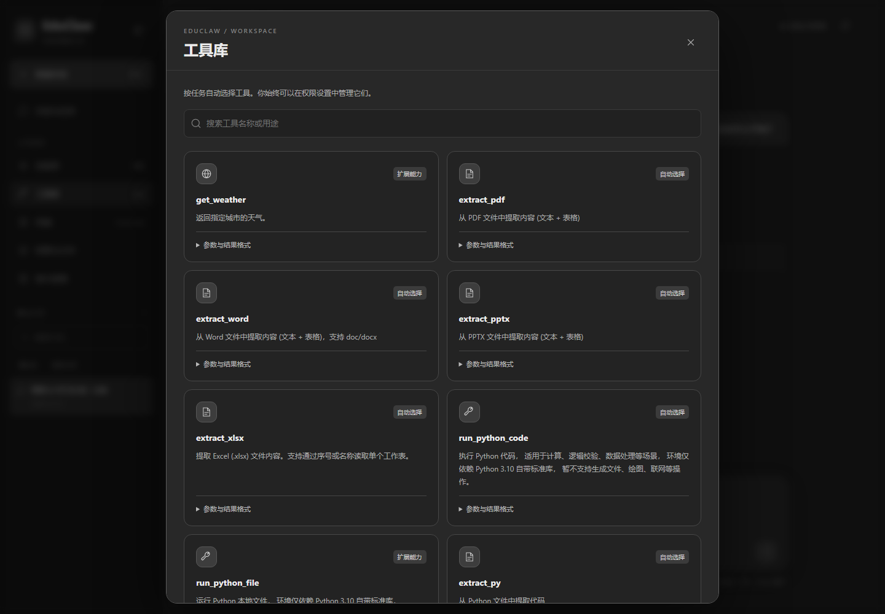

# 技能与工具

## Skill 与 Tool 的区别

Skill 是 `SKILL.md` 中的工作方法与领域指导；Tool 是实际执行能力，有参数、输出、权限和运行依赖。技能偏好按会话保存并作用于新任务，工具按目标自动选择。挂载、发现和允许执行是三件不同的事。



## 当前工具分类

| 类别 | 代表工具 | 说明 |
| --- | --- | --- |
| 公开检索 | public_search、news_search | Wikipedia 知识资料、Google News 公开 RSS |
| 文档提取 | extract_pdf、extract_word、extract_pptx、extract_xlsx | 根据格式和本地依赖提取内容 |
| 结构化数据 | extract_csv、extract_text、extract_json、extract_jsonl、profile_csv | 读取文本与数据，检查 CSV 质量 |
| 文件服务 | mcp_list_files、mcp_read_file、write_text_file | 官方 Filesystem MCP 的受控适配器 |
| Python | run_python_code | Docker 沙箱中的计算与结果处理 |
| 本机终端 | run_terminal | 指定目录的单次 PowerShell 命令 |
| 持续终端 | GUI 终端面板、CLI /term | 独立终端服务，支持交互与 Agent 循环 |

工具库显示实际契约与是否可规划；并非仓库中每个旧模块都可被当前任务规划器调用。

## 搜索范围

`public_search` 使用英文 Wikipedia，适合公开知识主题，不是通用全网搜索。`news_search` 读取 Google News RSS；支持最近 24 小时、北京时间今天、昨天、近 7 天，并按条目发布时间过滤。

两者无需搜索服务密钥，模型服务仍需配置。结果包含真实取得的来源，摘要不表示阅读全文；网络或源限制可能产生空结果。不要将搜索失败的生成性回答当成已核实资讯。

## 文件能力与范围

默认工作目录为数据目录下的 `workspace`，可用 `EDUCLAW_WORKSPACE_ROOT` 配置。官方 Filesystem MCP 仅允许配置根目录范围内操作；网关放行不代表文件服务会解除自己的限制。

专用写入支持 TXT、MD、JSON、JSONL、CSV、TSV、HTML、CSS、SVG，内容最多 200 KB；平衡模式新建自动执行，覆盖需确认，自主模式可自动覆盖。覆盖仍核对原内容摘要。此适配器不提供通用删除、移动或脚本写入，通用本机操作使用明确授权的终端。

文本与结构化输入有大小和格式限制。`extract_text` 的路径参数为 `text_path`；`extract_json` 为 `json_path`；`extract_jsonl` 为 `jsonl_path`；`profile_csv` 为 `csv_path`。以工具库展示的 Schema 为准，不根据工具名猜参数。

## 持续终端与单次终端

单次 `run_terminal` 支持现有本机绝对目录、命令与超时，不支持 UNC 起始目录和交互 stdin。命令结束、超时或取消后清理进程树，结果保留退出码及输出。

持续终端保留 cd、变量与交互程序。CLI 示例中的路径请替换成已有目录：

```text
/term open D:\projects\demo
OPEN
/term list
/term send <终端ID> Get-Location
/term agent <终端ID> 运行测试，根据错误修复，再次测试验证
/term read <终端ID>
/term approve <终端ID>
EXECUTE
/term interrupt <终端ID>
/term close <终端ID>
```

`approve` 仅在存在待审批输入时使用。平衡模式打开时可输入 `TRUST` 授权连续控制，也可用 `/term trust ID` 或 `/term revoke ID` 调整。逐步确认和自主执行模式优先；自主模式的整体权限应通过 `/autonomy balanced` 撤销。

## 技能库

场景技能包括项目对账 `project-audit`、学习进度 `learning-progress`、数据核查 `data-quality`、证据整理 `research-evidence`。仓库也包含文档、沙箱、检索和作业批改等技能，其业务成熟度与依赖各不相同。

上游 `community-frontend-design` 与 `community-mcp-builder` 保留来源提交信息和 Apache 2.0 许可证，见对应技能目录的 `SOURCE.json` 与 `LICENSE.txt`。附带脚本不会因为挂载技能而自动执行。

新增技能示例：

```markdown
---
name: example-skill
version: 1.0.0
description: 说明适用任务与工作方法
---

# 工作方法
先明确目标，再核查已取得的证据，按当前审批策略执行。
```

保存为 `skills/example-skill/SKILL.md` 后刷新技能库。技能内容不能扩大用户目标或授予工具权限。

## 标准 MCP 连接与接入

安装官方文件服务：`npm ci --prefix integrations/filesystem`。CLI `/mcp-tools` 检查服务，`/mcp-tools C:\path\mcp.json` 可读取标准 `mcpServers` 配置并发现工具。支持 stdio 和 Streamable HTTP，远程要求 HTTPS，本机允许 HTTP。

```json
{
  "mcpServers": {
    "example": {
      "type": "streamable-http",
      "url": "https://your-server.example/mcp",
      "header_env": {"Authorization": "MY_MCP_AUTHORIZATION"}
    }
  }
}
```

配置是本机可信配置，stdio 会启动指定程序。令牌通过本地环境变量提供。**发现不是执行授权**：第三方工具需注册受信任契约、实现适配器、通过权限和实机测试，不能依靠服务自述或自主模式跳过这些步骤。

开发入口：`core/tool_contracts/builtin.json`、`core/tools/__init__.py`；详见 [工具 SDK](https://github.com/weiyu687/EduClaw/blob/codex/roadmap-development/docs/TOOL_SDK.md)。权限规则见 [架构与安全](Architecture)。
